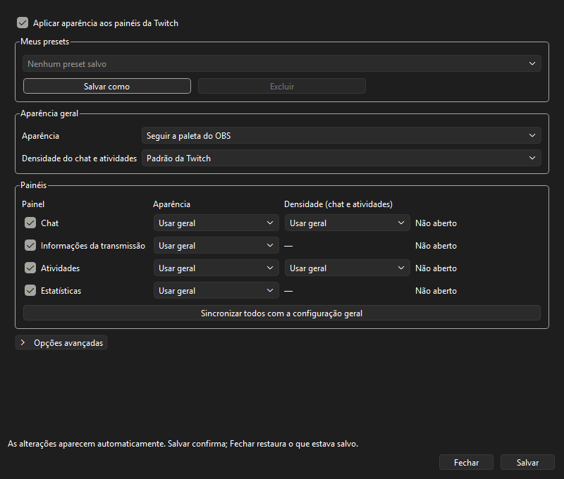

# Guia rápido

*Janela capturada em host Qt simulado; as cores acompanham o tema do OBS.*

## Usar

1. Abra **Ferramentas → Twitch Dock Themes**.
2. Escolha a aparência geral ou ajuste cada painel.
3. Ajuste a densidade do Chat e das Atividades.
4. Clique em **Salvar**. As mudanças aparecem na hora; sair sem salvar restaura a configuração anterior.

As cores personalizadas aparecem quando esse modo é escolhido.

## Presets

**Salvar como** guarda uma combinação pelo nome. Selecione-a na lista para carregar e clique em **Salvar** para confirmar o visual ativo.

Importar, exportar e restaurar o visual original ficam em **Opções avançadas**.

## Problemas

Abra o painel pelo menu Painéis do OBS e confira o login da Twitch. Se o problema continuar, copie **Opções avançadas → Diagnóstico dos painéis** e abra um [relato de bug](https://github.com/moska1m/twitch-dock-themes/issues/new?template=bug.yml).

Para voltar à DLL anterior, feche o OBS e execute `Restore-Previous.ps1`, se houver uma cópia salva.
